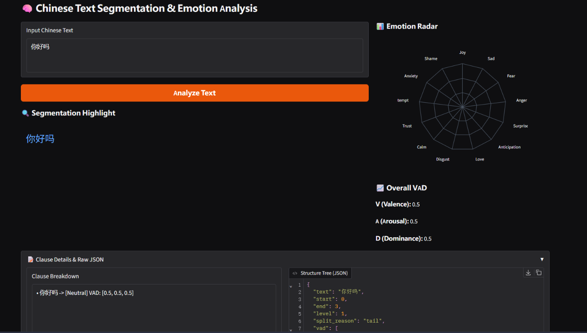

# w 中文语言结构与情感坐标分析引擎 (Intent-Recognition)

> **“这是我第一个真正意义上的独立开源项目，它源于我对语言结构与情感科学的好奇。目前它还有很多不足，非常欢迎各位同行、前辈提出宝贵的 Issue 与 PR。”**


## W Web Demo (可视化演示)



界面特点：
- **五层断句彩色高亮**：直观展示标点、主谓宾、语气、因果关系的切分逻辑。
- **13类情绪雷达图**：纯离线 SVG 渲染，实时展示文本中不同情绪的强度分布。
- **VAD 三维坐标**：Valence (效价)、Arousal (唤醒度)、Dominance (支配感)。

## W 项目简介

本项目并不是一个传统的“黑盒”深度学习模型，而是一个**基于数据库（数据驱动）的规则匹配工具**。
它将 **语言结构学、情感坐标（VAD）与结构化数据** 结合，通过科学的计算逻辑，对文本进行深度解构。

**主要面向人群**：
- 🎓 **语言结构学习者**：直观观察中文的主谓宾、因果、语气词是如何在代码层面被切分与解析的。
- 🔬 **情感科学学者**：通过 Valence (效价)、Arousal (唤醒度)、Dominance (支配感) 三维坐标，量化文本的情感倾向。
- 🗂️ **数据收集/标注者**：利用内置的“数据闭环”机制，快速从海量无标注文本中，提取高置信度的结构化伪标签数据（可用于训练大模型）。

## W 架构与工程实践

在这个项目中，我不仅尝试了语言学规则的代码化，更将其视为一次**软件工程化**的深度实践：

1. **数据驱动设计**：所有的主语库、谓语库、否定词、程度词、情感词，全部剥离为 JSON 数据库文件，代码只负责加载与计算，实现了逻辑与数据的完全解耦。
2. **防御性编程与容错**：编写了健壮的 `文件加载器` 与 `文本匹配器`。在处理百万级真实脏数据时，系统拥有严格的异常捕获机制，遇到乱码、空值或超长文本不会崩溃，而是安全跳过。
3. **结构规范与解耦**：将复杂的文本处理拆解为 L1 (标点) 到 L5 (树化) 的五层架构，每一层职责单一，接口清晰。
4. **极致的性能优化**：抛弃了传统的正则表达式与集合求交，手写了**双指针 Tokenizer** 算法，将时间复杂度降至 O(N)，单条文本推理仅需 0.2 毫秒。
5. **数据闭环**：内置子句级缓存与高置信度伪标签采集（Pseudo-labeling）机制，越跑越快，产出数据可直接反哺神经算法。

## W 快速体验

### 1. 基础调用 (Python API)
```python
from intent_recognition import Intent

# 初始化引擎
intent = Intent()

# 获取文本的三维情感坐标 (V, A, D)
vad = intent.vad_only("虽然今天很累，但是我很开心！")
print(f"VAD坐标: {vad}") 
# 输出: [0.48, 0.53, 0.43]

# 获取结构化情绪分布
emotions = intent.emotions_only("虽然今天很累，但是我很开心！")
print(f"情绪分布: {emotions}")


本项目内置了高置信度伪标签采集功能。如果你想用海量无标注数据（如百万级 CSV 文件）跑出带情感坐标的训练数据，可以直接开启 `save_data` 模式。

编写一个 `run.py`，挂机运行即可：

```python
from mod.intent_core.Node import Node

if __name__ == "__main__":
    Node(save_data=True).Data_Loading(start_row=0, end_row=None)